<!-- 🌸 SAKURA PROFILE HEADER -->

  

<h1 align="center">
  🌸 I'm Lasya! 🌸
</h1>

  <i><strong>Open to Internships</strong>  &&  <strong>Entry level jobs.</strong></i>

  

<table>
<tr>
<td width="60%" valign="top" align="left">

🎓 B.Tech in CSE (Core) at Narayana Engineering College, Nellore
   
 💻 Passionate about technology and problem-solving
  
 🎯 Short-term goal: Secure an on/off-campus placement
  
🚀 Long-term goal: Become a skilled Backend Developer
 
☕ Currently learning Java as my main programming language
 
🔧 Exploring backend technologies and development
 
🌐 Completed a Web Development Internship at CodSoft
 
🎶 Music is my motivation and creativity fuel.

 

**😄 Pronouns:** The lady boss? 👑

**⚡ Fun fact:** Forgetting what I've learned just now..... 🥲

</td>
<td width="40%" align="center" valign="middle">

<i>Keep calm and keep coding! 🌸</i>

</td>
</tr>
</table>

## 🌸 My Tech Garden

  
  
  
  
  
  
  
  
  
  
  
  
  
  
  
  

## 🌺 Let's Connect

  
  
  

## 🌸 GitHub Activity

  
  

  

  <i>"Like sakura blossoms, bloom beautifully in your own time."</i>
   

  

  <i>Thanks for visiting my little corner of GitHub!</i>
   
  🌸 Made with love by <a href="https://github.com/Meher01">Lasya</a> 🌸

